<div align="center">

# ZeRO, on 32 GPUs I Built Myself

**ERA V5 · Session 12 — Distributed Training I: Data Parallel and ZeRO**<br>
*"Make sure that it matches what ZeRO does."* — the line from class I built this whole repo around.

32 virtual GPUs made of threads (4 nodes × 8), ring collectives that pass real messages and count every byte, a memory ledger on every GPU,
and one GPT trained on them four ways: **data parallel, ZeRO-1, ZeRO-2, ZeRO-3** (+ CPU offload).
Then the same model on **32 real processes** with PyTorch's own DDP, ZeroRedundancyOptimizer and FSDP2, to check my simulator against the real thing.

[**📓 Notebook**](https://github.com/sourav-dhar/era-v5-s12-zero/blob/main/zero_on_32_virtual_gpus.ipynb) · [**🕹️ Interactive companion**](https://sourav-dhar.github.io/era-v5-s12-zero/) · [Results JSON](https://github.com/sourav-dhar/era-v5-s12-zero/tree/main/results) · [Tests](tests/test_core.py)

</div>

<p align="center">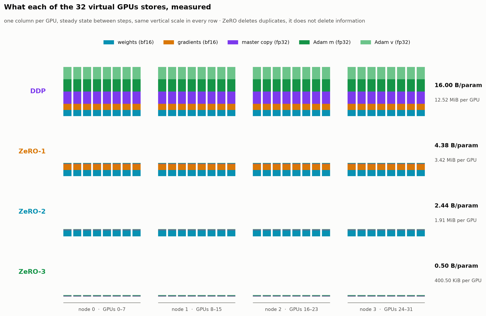</p>

---

## At a glance

| # | The assignment asked | What I measured |
|---|---|---|
| 1 | Create 32 virtual GPUs | 32 threads in 4 "nodes" of 8, each with a byte-exact memory ledger, a mailbox, and per-stream clocks. NVLink 450 GB/s inside a node, InfiniBand 50 GB/s between nodes. Ring collectives checked against the exact sum: max error **1e-14**, reduce-scatter → all-gather equals all-reduce **bit for bit**. |
| 2 | A demo model running on them | The Session 10/11 character GPT shrunk to **818,241** parameters, cut into 6 shardable units, trained for 100 steps on TinyShakespeare with a global batch of 128 sequences. |
| 3 | Simulate DDP, ZeRO-1/2/3 | All four train the **same model to the last bit**: losses, bf16 weights and fp32 master copies are `torch.equal` after 100 steps. One GPU on the whole batch agrees to **2e-15** in fp64. |
| 4 | Show how memory changes | **16 → 4.375 → 2.4375 → 0.5** bytes per parameter at N = 32, matching 16 · 4 + 12/N · 2 + 14/N · 16/N to every digit, for every N from 1 to 32. Plus what the formula hides: the **peak** inside a step is 22.7× the steady state under ZeRO-3. |
| 5 | Show how computation changes | Forward + backward FLOPs are **identical** in all four. The optimizer's work per GPU drops **32×**. Communication goes 2P · 2P · 2P · 3P (measured 1.9375 · 1.9375 · 1.9375 · 2.9062 P = 2(N−1)/N and 3(N−1)/N). With collectives blocking, DDP's network time is **32.8%** of compute on H100 and **74.8%** on B200: the lesson's 34% and 77%, times 31/32. |
| + | *"…make sure it matches what ZeRO does"* | PyTorch's DDP, ZeroRedundancyOptimizer and FSDP2 on 32 real processes train my model to within **7e-07** of my simulator. And they taught me two things the lesson's table doesn't say (§7). |

> **The one-sentence version:** ZeRO is not a new way to *compute* anything. Every arrangement does exactly the same arithmetic and ends with exactly the same weights. It is a decision about **who keeps which bytes**, paid for with **when bytes cross the wire**.

---

## ZeRO in my own words

**Where the 16 bytes come from.** Training one weight in mixed precision stores: the bf16 weight used in the matmuls (2 B), its bf16 gradient (2 B), an fp32 master copy that the optimizer actually updates (4 B, because adding tiny updates to a bf16 number rounds them away — I saw this myself in Session 10: a bf16 weight that receives +0.001 a thousand times never moves), and Adam's two running averages m and v in fp32 (4 + 4 B). 2 + 2 + 4 + 8 = **16 bytes**.

**What's redundant about data parallelism.** In DDP every GPU holds all 16 bytes of every weight. After the all-reduce every GPU has the *same* averaged gradient, applies the *same* Adam update to the *same* master weights and gets the *same* answer. With 32 GPUs, 31 of every 32 Adam updates are a GPU repeating what its neighbours are doing, and 31/32 of the cluster's optimizer memory is copies. ZeRO's idea is: give each GPU **ownership of 1/N of the weights**, keep the state only for what you own, and fetch anything else exactly when you need it.

**The three stages are three things you can stop replicating:**

| | what every GPU keeps in full | what every GPU keeps 1/N of | bytes / param | my one-line intuition |
|---|---|---|---|---|
| **DDP** | W, G, master, m, v | — | 16 | everyone does everything |
| **ZeRO-1** | W, G | master, m, v | 4 + 12/N | everyone computes gradients for everything, but only *updates* their slice |
| **ZeRO-2** | W | G, master, m, v | 2 + 14/N | …and only *keeps the gradient* for their slice: the rest is sent away the moment it exists |
| **ZeRO-3** | — | W, G, master, m, v | 16/N | …and doesn't even keep the weights: borrow each layer from the others when you reach it, give it back after |

**Why ZeRO-1 and ZeRO-2 are free on the wire.** This is the part I like most. A ring all-reduce *is* a reduce-scatter followed by an all-gather. After the reduce-scatter half, each GPU holds the fully summed gradient for exactly one slice: the slice it owns. DDP throws that fact away and keeps going to the all-gather. ZeRO-1/2 stop there, update the slice they own, and then all-gather the **new weights** instead of the gradients. Same two halves, same bytes: 2P. ZeRO-3 has no weights to keep between steps, so it must all-gather each layer **twice** (once for the forward, once for the backward), and the gradients still leave by reduce-scatter: 3P, half as much again.

**What ZeRO costs you, beyond bytes.** Stages 1 and 2 cost nothing in volume, but stage 2 must send gradients *during* the backward pass in buckets (so the full gradient never exists at once), and stage 3 puts a collective in front of every layer, which is only free if the next layer is prefetched while the current one computes. And clipping gets harder: no GPU holds the whole gradient anymore, so the global norm needs one more (tiny) collective.

---

## How I built 32 GPUs on a laptop

<p align="center">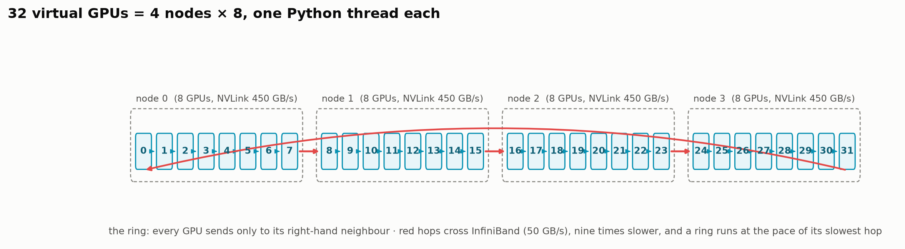</p>

My machine is a 12-thread laptop with 8 GB of RAM, so 32 real processes (each importing torch) were out. Instead each virtual GPU is a **thread** running the same SPMD function a `torch.distributed` script would run, and it only knows its rank:

- **A memory ledger.** Every tensor a GPU keeps is registered with a category (bf16 weights, bf16 grads, fp32 master, Adam m, Adam v, a gathered layer, a gradient bucket, activations) and its *real* `numel × element_size`, and freed explicitly. Activations are counted with autograd's `saved_tensors_hooks`, excluding the weights themselves. The ledger asserts on double allocation, so a leak crashes instead of drifting.
- **Ring collectives.** Reduce-scatter and all-gather are the NCCL ring algorithms: N−1 hops per phase, every GPU sends one chunk to its right-hand neighbour per hop. I implemented them twice: `mailbox` mode, where every hop is a real message between threads, and `rendezvous` mode, where all ranks meet at a barrier and one thread plays the same hops for everyone. They produce **bit-identical** training runs, down to every simulated timestamp (a test checks it). Rendezvous is 5× faster on the 32-GPU collective check, and far more in training, because 31 sequential thread hand-offs per collective cost Python a lot more than they cost a real interconnect.
- **Clocks per stream.** Like CUDA streams: compute, all-gather, reduce-scatter, PCIe. A chunk takes `bytes / bandwidth` of the link it crosses, can't start before the receiver has entered the collective, and the compute stream waits only when it needs a result. That gives every step a simulated duration with real overlap and real waiting.
- **Calibrated virtual cards.** The ratio of communication to compute doesn't depend on model size at all, only on tokens per GPU and FLOP/s per byte/s. So I scaled the virtual card so that my 256-token-per-GPU step has the same compute-to-network ratio as the lesson's step (1M tokens on 64 GPUs, 40% MFU). Bandwidths are the real ones.
- **Where it ran.** The tests and the 8-GPU `quick` profile run on the laptop. The reported 32-GPU notebook ran on a 16-core Modal CPU container (`modal run tools/modal_app.py::notebook`), because at the peak of a 32-GPU step all 32 ranks hold their activations at once and my laptop ran out of memory (see §8). Same code, same numbers; only the CPU-millisecond timings depend on the machine.
- **Precision as in the lesson:** bf16 weights and gradients, fp32 master and Adam. My CPU runs bf16 matmuls 8× slower than fp32, so the matmuls run on fp32 copies of the bf16 weights (bf16 in, fp32 accumulate, which is what a tensor core does anyway). The ledger counts what a GPU would store.

---

## 1 · The same model, four ways

<p align="center">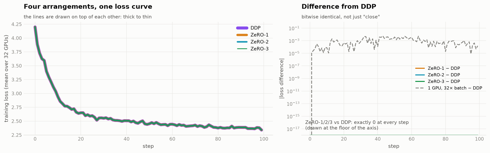</p>

| arrangement | final loss | loss = DDP at every step | fp32 master = DDP | bf16 weights = DDP |
|---|--:|:-:|:-:|:-:|
| DDP | 2.3403 | ✅ | ✅ all bits | ✅ all bits |
| ZeRO-1 | 2.3403 | ✅ | ✅ all bits | ✅ all bits |
| ZeRO-2 | 2.3403 | ✅ | ✅ all bits | ✅ all bits |
| ZeRO-3 | 2.3403 | ✅ | ✅ all bits | ✅ all bits |

Not "close": `torch.equal` on all 818,241 weights. Getting there took two decisions. The ring fixes the order in which the 32 gradients are added, so every arrangement sums in the same order no matter which thread runs first. And **gradient clipping** under ZeRO can't see the whole gradient, so each GPU sums the squares of its own slice and the 32 partial sums are all-gathered (32 floats, 124 bytes) and added in rank order; DDP does the identical sum locally.

**"DDP = one GPU with a 32× batch"** (lesson §3). In fp64, one GPU fed all 128 sequences and ZeRO-3 on 32 GPUs end 10 steps apart by **2.4e-15** in the worst weight: summation-order rounding and nothing else. In bf16 the two loss curves drift apart by up to **0.006**, and that taught me something: the ring adds 32 bf16 gradients one hop at a time and rounds 31 times, while one GPU accumulates in fp32 and rounds once. Same maths, different rounding. That's why frameworks offer fp32 gradient reduction.

---

## 2 · Memory

### What one GPU holds, per category, against the lesson

GPU 0's ledger between steps, divided by the stored parameter count (each unit is padded so it splits into 32 equal, 16-element-aligned slices: 820,224 stored vs 818,241 real, +0.24%).

| arrangement | W bf16 | G bf16 | master fp32 | Adam m | Adam v | **measured B/param** | lesson | MiB on GPU | peak MiB (when) |
|---|--:|--:|--:|--:|--:|--:|--:|--:|--:|
| DDP | 2.0000 | 2.0000 | 4.0000 | 4.0000 | 4.0000 | **16.0000** | 16.0000 | 12.52 | 20.99 (fwd head) |
| ZeRO-1 | 2.0000 | 2.0000 | 0.1250 | 0.1250 | 0.1250 | **4.3750** | 4.3750 | 3.42 | 11.89 (fwd head) |
| ZeRO-2 | 2.0000 | 0.0625 | 0.1250 | 0.1250 | 0.1250 | **2.4375** | 2.4375 | 1.91 | 10.38 (fwd head) |
| ZeRO-3 | 0.0625 | 0.0625 | 0.1250 | 0.1250 | 0.1250 | **0.5000** | 0.5000 | 0.39 | 8.88 (fwd head) |
| ZeRO-1 + offload | 2.0000 | 2.0000 | 0.0000 | 0.0000 | 0.0000 | **4.0000** | 4.0000 | 3.13 | 11.60 (fwd head) |
| ZeRO-2 + offload | 2.0000 | 0.0625 | 0.0000 | 0.0000 | 0.0000 | **2.0625** | 2.0625 | 1.61 | 10.09 (fwd head) |
| ZeRO-3 + offload | 0.0625 | 0.0625 | 0.0000 | 0.0000 | 0.0000 | **0.1250** | 0.1250 | 0.10 | 8.59 (fwd head) |

Every category is exactly 2, 2, 4, 4, 4 bytes or that divided by 32: the notebook `assert`s the match to 1e-12. Look at where the bytes go, row by row: ZeRO-1 removes the three fp32 tensors (12 of 16 bytes), ZeRO-2 the gradient, ZeRO-3 the weights.

<p align="center">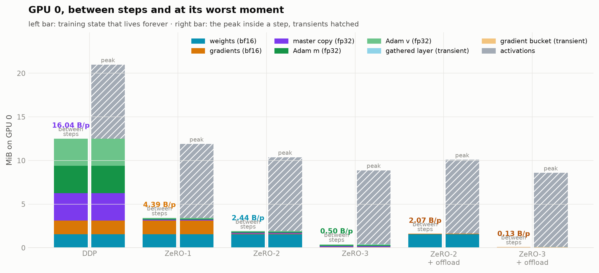</p>

### What the formula doesn't show: the peak

<p align="center">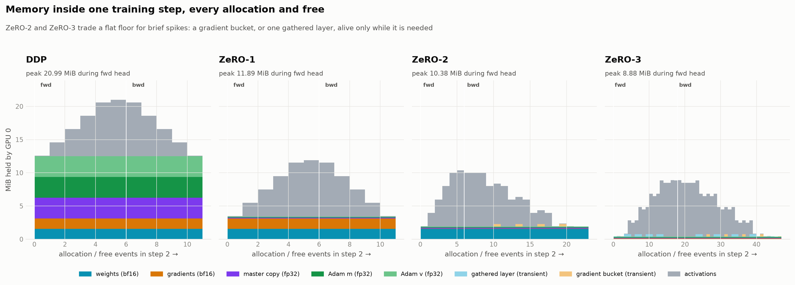</p>

This is every allocation and free on GPU 0 during one step. The lesson's table is the flat floor. On top of it, the **activations** pile up through the forward pass and drain in the backward, and no ZeRO stage touches them. At this scale the peak is 1.7× the steady state for DDP and 22.7× for ZeRO-3. ZeRO-2 adds a short spike: a full gradient **bucket** that exists for one layer's backward until it is reduce-scattered. ZeRO-3 adds one **gathered layer** that exists only while that layer computes (the light blue slivers). The more I shard, the more the peak is set by things the formula doesn't count, which is exactly the lesson's warning about leaving room for activations. On a real card the peak, not the steady state, decides whether you crash.

### For every N

<p align="center">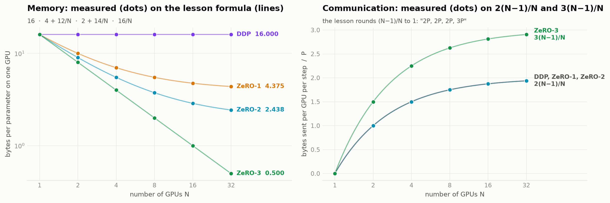</p>

N = 1, 2, 4, 8, 16, 32: all 24 points land on the formula lines (left), and on 2(N−1)/N and 3(N−1)/N for communication (right).

**Leak check.** The instructor described memory slowly creeping up over a hundred steps because something sharded is never freed. My ledger records the bytes still allocated at the end of every step: drift **0 bytes** over 100 steps for all four arrangements.

---

## 3 · Communication

<p align="center">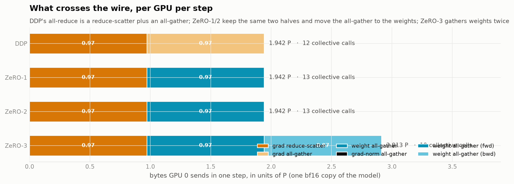</p>

| arrangement | sent by GPU 0 per step | without the grad-norm floats, / padded P | lesson | collective calls |
|---|--:|--:|--:|--:|
| DDP | 1.9422 P | 1.93750 | 2P ≈ 1.9375 | 12 |
| ZeRO-1 | 1.9423 P | 1.93750 | 2P ≈ 1.9375 | 13 |
| ZeRO-2 | 1.9423 P | 1.93750 | 2P ≈ 1.9375 | 13 |
| ZeRO-3 | 2.9134 P | 2.90625 | 3P ≈ 2.9062 | 19 |

- DDP and ZeRO-1/2 send **exactly the same bytes**: the gradient reduce-scatter, then an all-gather (of gradients in DDP, of bf16 weights in ZeRO-1/2).
- ZeRO-3's extra P is the second weight all-gather, the one before the backward.
- ZeRO-3 makes **19 collective calls** per step against DDP's 12. At this toy size that's free, but on real hardware every call pays a fixed launch latency, which is why small layers are bad for ZeRO-3 and why buckets exist.
- The only traffic outside 2P/3P is the clipping norm: 31 hops × 4 bytes. That's 10⁻⁴ of P, but it's a synchronisation point that DDP doesn't have.

---

## 4 · Computation and time

### What each GPU computes

| arrangement | fwd + bwd GFLOP / GPU / step | parameters updated by GPU 0 | share of the model | CPU ms in optimizer / step |
|---|--:|--:|--:|--:|
| DDP | 1.338 | 820,224 | 1.0000 | 113.66 |
| ZeRO-1 | 1.338 | 25,632 | 0.0312 | 88.34 |
| ZeRO-2 | 1.338 | 25,632 | 0.0312 | 81.15 |
| ZeRO-3 | 1.338 | 25,632 | 0.0312 | 92.66 |

The forward and backward FLOPs are identical in all four arrangements: **ZeRO divides storage, never arithmetic.** What it does divide is the optimizer. Under ZeRO-1/2/3 each GPU updates 25,632 parameters instead of 820,224, and the simulated clock charges it 6.86 µs → 0.21 µs. The real CPU wall-clock barely shows it (114 → 88 ms per step): with 32 threads sharing one Python interpreter, updating a 25,632-element slice is dominated by Python overhead, not arithmetic. That's why I trust the clock model for time and the ledger for memory, and treat the laptop's milliseconds as noise. ZeRO-3 adds no FLOPs either: its cost is in *when* the weights arrive.

### A step on the clock

| card | arrangement | compute µs | optimizer µs | network µs, blocking (÷ compute) | network µs left after overlap |
|---|---|--:|--:|--:|--:|
| H100 | DDP | 193.7 | 6.86 | 63.6 (32.8%) | 16.7 (8.6%) |
| H100 | ZeRO-1 | 193.7 | 0.21 | 63.6 (32.8%) | 16.7 (8.6%) |
| H100 | ZeRO-2 | 193.7 | 0.21 | 63.6 (32.8%) | 16.7 (8.6%) |
| H100 | ZeRO-3 | 193.7 | 0.21 | 95.4 (49.2%) | 23.5 (12.1%) |
| B200 | DDP | 85.0 | 2.87 | 63.6 (74.8%) | 20.6 (24.2%) |
| B200 | ZeRO-1 | 85.0 | 0.09 | 63.6 (74.8%) | 19.0 (22.4%) |
| B200 | ZeRO-2 | 85.0 | 0.09 | 63.6 (74.8%) | 19.0 (22.4%) |
| B200 | ZeRO-3 | 85.0 | 0.09 | 95.4 (112.2%) | 26.5 (31.2%) |

<p align="center">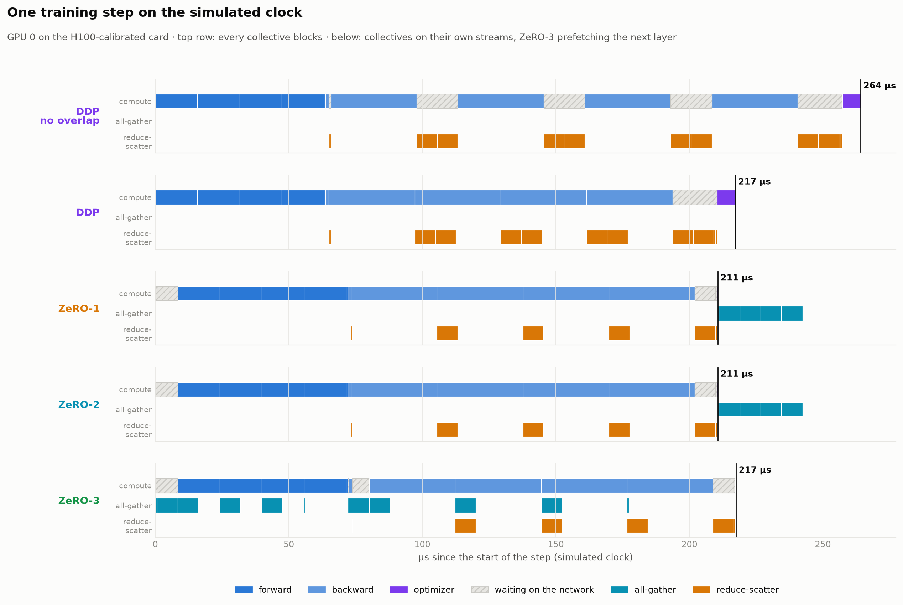</p>

- **The lesson's §5 numbers, reproduced.** With every collective blocking, DDP's network time is 32.8% of compute on the H100-calibrated card and 74.8% on B200, against the lesson's 33.8% and 76.9% × (N−1)/N = 32.7% and 74.5%. The last 0.1–0.3 points are my 0.24% shard padding (P is a little bigger than Ψ × 2 bytes). My first clock gave 30.4%: it let a GPU send before its neighbour had entered the collective. Fixing that is what made it land.
- **Faster cards raise the ratio** (lesson §5). The bytes don't change, the compute they have to hide behind shrinks 2.28×.
- **Overlap hides most of it, not all.** Gradients for the last layers leave while earlier layers are still in backward, and ZeRO-3 gathers the next layer while the current one computes. On H100 that takes DDP from 32.8% to **8.6%** of compute (74% of the transfer hidden; the lesson's widget gets 83% with two-layer buckets on its H100 step) and ZeRO-3 from 49.2% to 12.1%. What stays exposed is the tail: the buckets of the *first* layers are ready only when the backward pass is over, so there is nothing left to hide them behind.
- **Where the leftover sits moves with the stage** (look at the hatching in the timeline). DDP waits only at the very end, 16.7 µs for the last gradient buckets. ZeRO-1/2 split it: 8.4 µs at the *start* of the next step, because the first layer can't run until the weight all-gather issued after the optimizer arrives, and 8.4 µs at the end. ZeRO-3 adds a third gap of 6.8 µs where forward turns into backward: the head was freed after the forward and has to be gathered again. (FSDP2 skips resharding the root module after the forward pass for exactly this reason.)
- **On B200, ZeRO-3 can't be hidden even in principle.** Its blocking network time is **112.2%** of compute: more transfer than there is work to hide it behind. Overlap still brings it to 31.2%, but this is the lesson's point about faster cards made concrete: the 3P that was a footnote on H100 becomes the bottleneck on B200 ([B200 timeline](figures/08b_timeline_B200.png)).

<p align="center">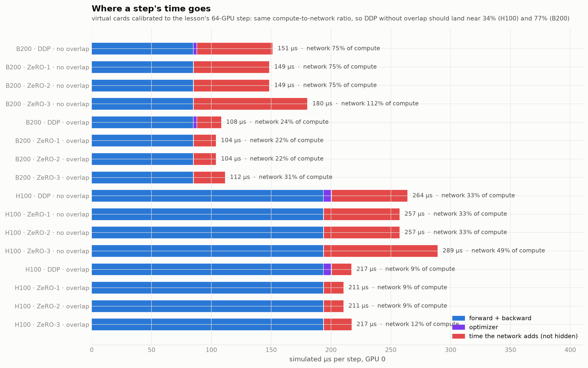</p>

### How many GPUs per node?

The same 32 GPUs wired three ways, collectives blocking (network ÷ compute):

| arrangement | 1 node(s) × 32 | 4 node(s) × 8 | 32 node(s) × 1 |
|---|--:|--:|--:|
| DDP | 3.6% | 32.8% | 32.8% |
| ZeRO-1 | 3.6% | 32.8% | 32.8% |
| ZeRO-2 | 3.6% | 32.8% | 32.8% |
| ZeRO-3 | 5.5% | 49.2% | 49.2% |

This surprised me. **4 nodes × 8 costs exactly as much as 32 single-GPU machines.** A flat ring runs at the pace of its slowest hop, and with 4 nodes the 4 InfiniBand hops set the pace for all 32. More GPUs per node only helps a flat ring when *every* hop is NVLink. So the lesson's open question "how many GPUs per node" is really a question about **hierarchical collectives**: reduce inside the node first so only 1/8 of the data crosses the slow link. NCCL does this; my flat ring shows why it has to.

---

## 5 · Offload to the CPU

| arrangement | GPU MiB | CPU MiB (per GPU) | GPU B/param | PCIe KiB / step | step µs |
|---|--:|--:|--:|--:|--:|
| ZeRO-1 | 3.42 | 0.00 | 4.386 | 0.0 | 210.6 |
| ZeRO-1 + offload | 3.13 | 0.29 | 4.010 | 100.1 | 218.5 |
| ZeRO-2 | 1.91 | 0.00 | 2.443 | 0.0 | 210.6 |
| ZeRO-2 + offload | 1.61 | 0.29 | 2.067 | 100.1 | 218.5 |
| ZeRO-3 | 0.39 | 0.00 | 0.501 | 0.0 | 217.4 |
| ZeRO-3 + offload | 0.10 | 0.29 | 0.125 | 100.1 | 226.1 |

Offload moves the fp32 master and Adam's m and v (12 of the 16 bytes) to system memory and runs the update there. ZeRO-2 drops to 2 + 2/N on the GPU, ZeRO-3 to 4/N. The price is two PCIe crossings per step (gradients down, bf16 weights up) at 60 GB/s and a slower optimizer. It trades **memory for bandwidth**, so it only earns its place when GPU memory is the binding constraint (lesson §8). It also changes the arithmetic by nothing: offload runs are bit-identical to their GPU twins.

---

## 6 · Scaling it to V5: 30 billion parameters

Bytes per parameter don't depend on the model's size, so a 30B model's per-GPU state is just my measured bytes/param × 30 × 10⁹:

| arrangement | 8 GPUs | 16 GPUs | 32 GPUs | 64 GPUs | lesson §7 (8 · 16 · 32 · 64) |
|---|--:|--:|--:|--:|---|
| DDP | 447.0 | 447.0 | 447.0 | 447.0* | 447.0 · 447.0 · 447.0 · 447.0 |
| ZeRO-1 | 153.7 | 132.7 | 122.2 | 117.0* | 153.7 · 132.7 · 122.2 · 117.0 |
| ZeRO-2 | 104.8 | 80.3 | **68.1** | 62.0* | 104.8 · 80.3 · **68.1** · 62.0 |
| ZeRO-3 | **55.9** | 27.9 | 14.0 | 7.0* | **55.9** · 27.9 · 14.0 · 7.0 |

GiB per GPU; `*` = beyond my 32-GPU sweep, formula only. Every measured cell matches the lesson to 0.1 GiB.

<p align="center">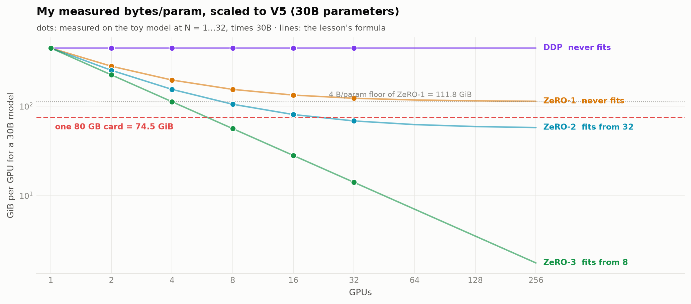</p>

DDP and ZeRO-1 **never** fit on a 74.5 GiB card: both replicate bf16 weights + gradients, 4 B × 30B = 111.8 GiB, on one card or on a thousand. That floor fills a card at exactly 20.0B parameters, which is why V4 got away with ZeRO-2 and V5 can't get away with ZeRO-1. ZeRO-2 fits from 32 GPUs, ZeRO-3 from 8. That's training state only; §2 showed the activations come on top.

---

## 7 · Reality check: PyTorch's own ZeRO, on 32 real processes

A simulator can be consistently wrong, so I ran the same model, init, data and AdamW on **32 real processes** with `torch.distributed` (gloo, CPU, on [Modal](https://modal.com), `modal run tools/modal_app.py::main`, torch 2.15.0+cpu), using PyTorch's implementations instead of mine. Everything is fp32 there, so the state is 4 + 4 + 8 = 16 B/param and P = 4 B × Ψ. Each rank measured the bytes of the tensors it holds, and I wrapped `torch.distributed`'s collectives to record every payload.

| PyTorch | params B/p | grads B/p | AdamW B/p | rank 0 total | AdamW max ÷ min over ranks | collectives per step | ring bytes / rank | max \|loss − my sim\| |
|---|--:|--:|--:|--:|--:|---|--:|--:|
| `ddp` | 4.000 | 4.000 | 8.000 | **16.000** | 1.00× | all_reduce 1.00P | 1.94 P | 7.2e-07 |
| `zero1` | 4.000 | 4.000 | 0.641 | **8.641** | 128.00× | all_reduce 1.00P, broadcast 1.00P | 2.91 P | 7.2e-07 |
| `fsdp2_zero2` | 0.126 | 0.126 | 0.252 | **0.505** | 1.03× | all_gather_single 1.01P, reduce_scatter_single 1.01P | 1.96 P | 7.2e-07 |
| `fsdp2_zero3` | 0.126 | 0.126 | 0.252 | **0.505** | 1.03× | all_gather_single 2.02P, reduce_scatter_single 1.01P | 2.93 P | 7.2e-07 |

<p align="center">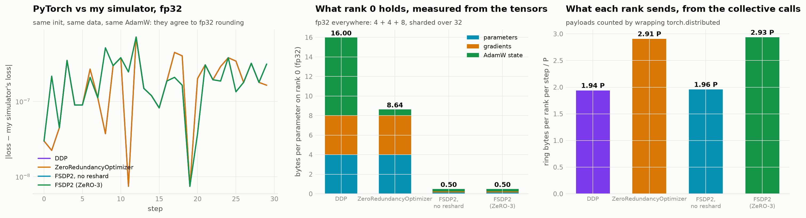</p>

**They all train my model.** Final loss 2.5871 for all four, and every step stays within 7e-07 of my simulator in fp32. Memory is exactly the fp32 version of the theory: 16 → 8 + 8/N → 16/N. FSDP2 without resharding moves 2P (one weight all-gather + one gradient reduce-scatter, ZeRO-2's volume) and FSDP2 proper moves **3P**, the lesson's number.

**Surprise 1: PyTorch's "ZeRO-1" sends 3P, not 2P.** `ZeroRedundancyOptimizer` sits on top of DDP, so it keeps DDP's full gradient all-reduce (2P) and *then* broadcasts every updated parameter from its owner (+1P). The ZeRO paper's stage 1 replaces the all-reduce with a reduce-scatter and gets the shards for free. PyTorch's version saves the memory but pays 50% more traffic than DDP.

**Surprise 2: sharding is not even, and the busiest rank is the one that dies.** `ZeroRedundancyOptimizer` hands out **whole tensors** to ranks (greedy by size), so rank 0's AdamW state is 2.6× the ideal 8/32 and the largest rank holds 128.0× the smallest. FSDP2 cuts every tensor along dim 0 instead, which is far more even (1.03×) but has its own edge: the 65-row token embedding is cut into chunks of ⌈65/32⌉ = 3 rows, so ranks 0–20 get 3 rows, rank 21 gets 2, and **10 of 32 ranks get nothing**. In class the instructor said a run can crash on one rank because "one GPU has slightly more". This is that, measured.

<p align="center">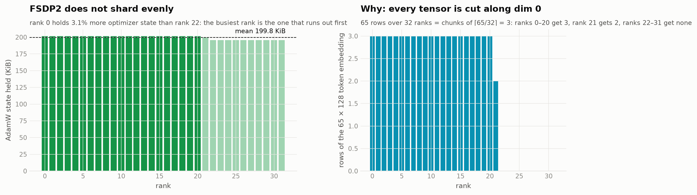</p>

---

## 8 · What bit me while building it

Every one of these was silent: the loss went down every time.

1. **The 32 GPUs weren't starting from the same weights.** Every rank builds the model from seed 0, but `torch.manual_seed` is process-wide, and 32 threads were seeding and drawing from one generator at the same time. Two runs of the *same* config disagreed at step 0. A lock around model construction fixed it. It's the guarantee DDP gets for free by broadcasting rank 0's weights at start-up, and I had to rebuild it by hand.
2. **Gradient clipping was 32× too aggressive.** My slices hold *summed* gradients (I divide by N in the update), and I computed the clipping norm on the sums, so at N = 32 the norm was 32× too large and clipping fired on every step. Nothing looked wrong. It was caught only by my test "N GPUs must equal 1 GPU on an N× batch, in fp64", which failed by 4e-4 instead of 1e-15. The norm has to be of the *mean* gradient.
3. **Three weights out of 818,241.** ZeRO-1's fp32 master differed from DDP's in exactly 3 elements, by 1e-9, all in the last 9 positions of a 1,081-element slice. The CPU's SIMD loop uses fused multiply-add and the scalar tail loop doesn't, so the same Adam formula rounds differently in the tail. Padding every slice to a multiple of 16 elements made all four arrangements bit-identical. Real libraries align their shards too.
4. **A network faster than physics.** My first clock let a GPU push a chunk to its neighbour before the neighbour had entered the collective, so the ring finished 7% faster than (N−1)/N × P / bandwidth allows. NCCL writes into a buffer the receiver has posted. Adding that "ready" handshake put DDP's network share on the lesson's 34% × 31/32.
5. *(Not a bug, a lesson.)* My notebook died of out-of-memory twice, on a laptop simulating a memory-saving technique. The first time, every run was keeping 32 GPUs' worth of weights alive for the equality checks, and freeing them once checked fixed it. The second time, the training state was tiny but **32 ranks' activations alive at the same moment** were not, which is §2's point about peaks, felt first-hand. The full run moved to a 16-core cloud CPU box.

---

## 9 · Pros and cons of each stage, and what I'd pick

| | memory / GPU (N = 32) | sent / GPU / step | pros | cons | I'd use it when |
|---|--:|--:|---|---|---|
| **DDP** | 16.00 B/p | 2P | simplest; no gather before any layer; fewest collectives | 15/16 of the cluster's memory is copies; every GPU repeats the same Adam update | the model and Adam fit on one card with room for activations |
| **ZeRO-1** | 4.38 B/p | 2P | 12 of 16 bytes sharded **for free**; optimizer work ÷ N | bf16 weights + grads (4 B/p) stay on every card: a floor no N lowers. PyTorch's version costs 3P and shards unevenly | almost always instead of DDP |
| **ZeRO-2** | 2.44 B/p | 2P | down to a 2 B/p floor at the same traffic; what V4 ran | weights still replicated (30B needs ≥ 32 cards); gradient buckets add to the peak and need tuning | weights fit, Adam doesn't |
| **ZeRO-3** | 0.50 B/p | 3P | no floor: memory scales with the cluster; 30B fits on 8 cards; FSDP2 is native PyTorch | +50% traffic, 19 collectives per step, latency-bound on small layers, needs prefetch; uneven dim-0 shards | the model itself doesn't fit |

**For V5 at 30B** the table leaves two options: **ZeRO-2 on 32+ GPUs** (68.1 GiB of state, which leaves almost no room for activations on a 74.5 GiB card) or **ZeRO-3 on 8+**. My timeline says ZeRO-3's extra P hides behind the compute on H100 if the next layer is prefetched, and becomes visible first on B200. My topology run says the inter-node link, not the GPU count, sets the price of every collective. So I'd start with **ZeRO-3 (FSDP2) with prefetch, hierarchical collectives, communication logged as a share of compute from step one**, and I'd budget memory by the **peak** inside a step and by the **busiest rank**, not by the formula.

---

## What this does not show (honestly)

- My GPUs are threads and my memory is a ledger. It counts what each GPU would store, exactly, but it isn't device memory: there's no allocator fragmentation, no CUDA context, no NCCL buffers.
- Time is simulated: bandwidth-only links (no per-message latency by default) and a compute model from measured FLOPs. The *ratios* match the lesson by construction of the calibration; absolute microseconds mean nothing.
- The model is tiny (818K parameters), so activations dominate its peak far more than they would at 30B with activation checkpointing.
- The real-process check runs on CPU with gloo in fp32: it validates *what is stored and what is sent*, not GPU speed.

---

## Reproduce

```bash
pip install torch numpy pandas matplotlib nbformat nbconvert ipykernel pytest
python -m pytest -q tests                                   # 11 tests: collectives, bit-identity, formulas, 1 GPU = N GPUs
python tools/build_notebook.py                              # tools/notebook_cells.md -> zero_on_32_virtual_gpus.ipynb
python tools/run_notebook.py --profile full --out zero_on_32_virtual_gpus.ipynb   # needs ~4 GB free RAM
modal run tools/modal_app.py::main                          # the 32 real processes (CPU containers, a few cents)
modal run tools/modal_app.py::notebook                      # the reported notebook run (16-core CPU container)
python tools/export_site.py && python tools/make_readme.py  # companion page data + this README
```
`S12_PROFILE=quick` runs every cell with 8 GPUs in a few minutes.

## Repository

```
zero_on_32_virtual_gpus.ipynb   the executed notebook: every number and figure in this README
s12/vgpu.py                     the 32 virtual GPUs: memory ledger, ring collectives (mailbox + rendezvous), stream clocks
s12/zero.py                     DDP / ZeRO-1 / ZeRO-2 / ZeRO-3 / offload as one SPMD training loop
s12/model.py                    the GPT, cut into shardable units; TinyShakespeare
s12/hw.py, s12/theory.py        the lesson's hardware constants and formulas
s12/real_dist.py                the same model on real torch.distributed: DDP, ZeroRedundancyOptimizer, FSDP2
s12/plots.py, s12/style.py      figures
tests/test_core.py              what has to stay true
tools/                          notebook builder/runner, Modal app, site export, README generator
results/                        summary.full.json, site.full.json, real_dist.json
docs/index.html                 the interactive companion page (GitHub Pages)
```
